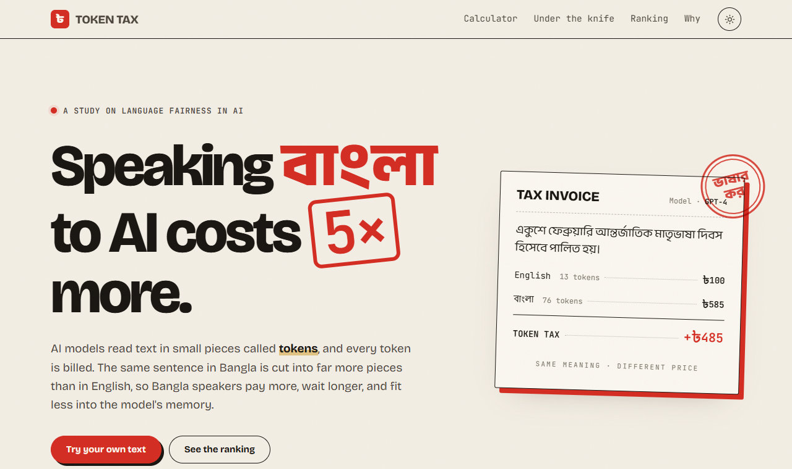
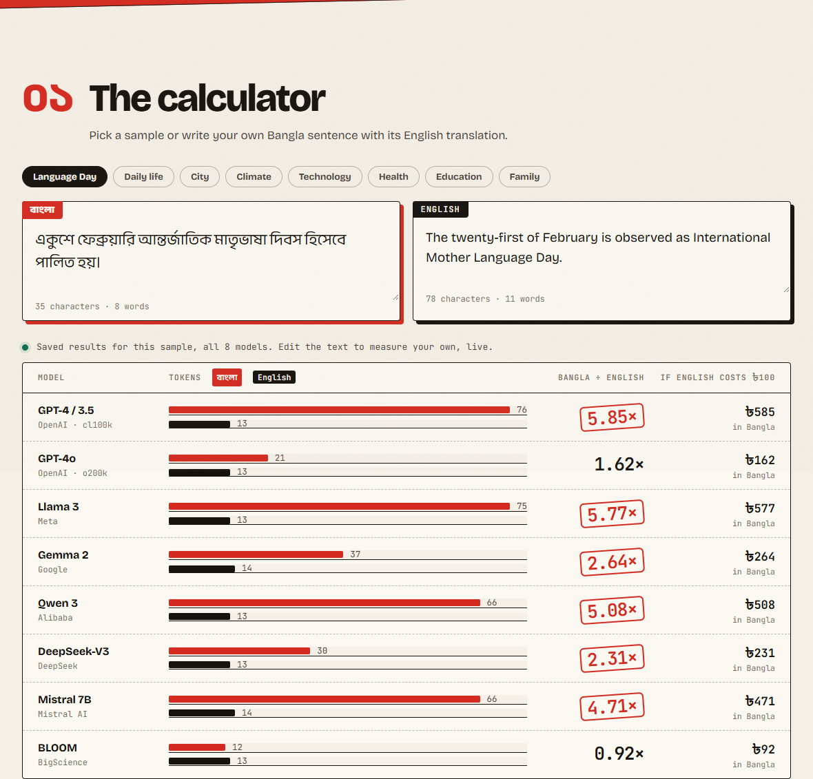
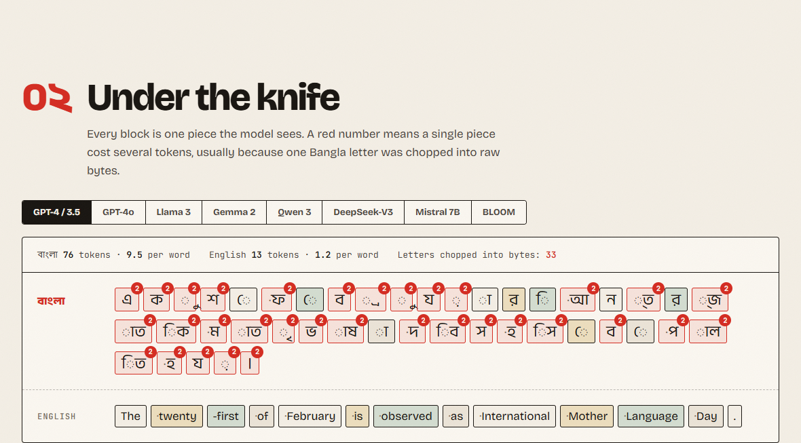
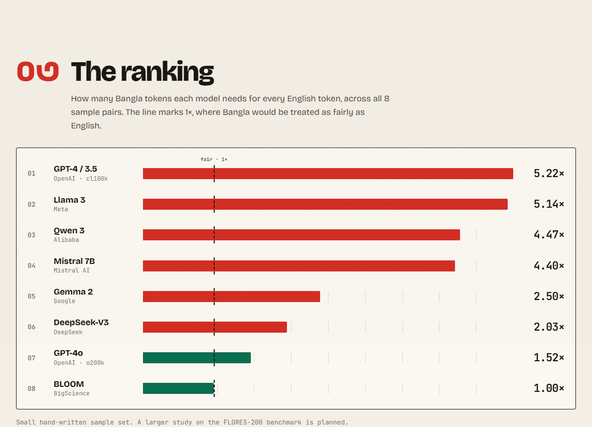

# Token Tax: Bangla vs English in AI

**Does it cost more to talk to AI in Bangla than in English? Yes, often about 5 times more.**
This website lets anyone see that for themselves, live in the browser.

### 👉 [Open the live website](https://lamia-mim.github.io/token-tax/)



---

## The idea in one minute

AI models like ChatGPT do not read whole words. They cut text into small pieces called **tokens**, and companies charge for every token.

For English, a common word is usually one token. For Bangla, the AI often cuts a single letter into two or three pieces, because it learned mostly from English text.

So the **same sentence** costs very different amounts:

| | Sentence | Tokens (GPT-4) |
|---|---|---|
| English | The twenty-first of February is observed as International Mother Language Day. | **13** |
| Bangla | একুশে ফেব্রুয়ারি আন্তর্জাতিক মাতৃভাষা দিবস হিসেবে পালিত হয়। | **76** |

That is almost **6 times** more tokens for the same meaning. More tokens means:

- 💸 **Higher cost:** a Bangladeshi app using AI pays more for the same feature.
- 🐢 **Slower replies:** AI writes one token at a time, so Bangla answers take longer.
- 🧠 **Less memory:** AI can only hold a fixed number of tokens, so it reads less Bangla text at once.

I call this extra cost the **"token tax"**. In 1952, people in what is now Bangladesh fought for the right to speak Bangla. This project asks whether AI treats the language fairly today.

## What I found

I compared 8 popular AI models on 8 sentences, each written in both Bangla and English. The number shows how many Bangla tokens each model needs for every English token. **1.00× would be perfectly fair.**

| Model | Made by | Bangla vs English |
|---|---|---|
| GPT-4 / GPT-3.5 | OpenAI | **5.22×** |
| Llama 3 | Meta | 5.14× |
| Qwen 3 | Alibaba | 4.47× |
| Mistral 7B | Mistral AI | 4.40× |
| Gemma 2 | Google | 2.50× |
| DeepSeek-V3 | DeepSeek | 2.03× |
| GPT-4o | OpenAI | 1.52× |
| BLOOM | BigScience | **1.00×** |

**Key takeaways**

1. Most popular models need **4 to 5 times more tokens** for Bangla.
2. Things are improving. OpenAI's newer GPT-4o cut the gap from about 5× to about 1.5×.
3. **BLOOM is fair (1.00×).** Its tokenizer was built from training data that deliberately included Bangla, which suggests the gap comes from what a model learns from, not from the language itself.

> These results come from a small set of 8 sentences I wrote for this project, so treat them as an early signal, not a final answer. A larger study is planned (see the Roadmap section below).

## How to use the website

1. **Open** [lamia-mim.github.io/token-tax](https://lamia-mim.github.io/token-tax/). Results for a sample sentence appear right away.
2. **Pick a sample** (Daily life, Health, Climate…) or **type your own** Bangla sentence and its English translation.
3. **Read the table.** For each model you see the token counts, how many times more Bangla costs, and what that means in money ("if English costs ৳100, Bangla costs ৳585").
4. **Scroll down** to see how each model cuts your Bangla into pieces, and the full ranking.

When you type your own text, the site downloads the models' tokenizers (about 23 MB the first time, then cached). Your text **never leaves your device**. Everything runs in your browser.

### What's on the page

| Section | What it shows |
|---|---|
| **The calculator** | Token counts and cost for your text, across all 8 models |
| **Under the knife** | Each piece the model sees. A red number means one piece cost several tokens. |
| **The ranking** | All models ranked from least to most fair |
| **Why it matters** | Cost, speed and memory, explained simply |







---

## For developers

### How it works

- Tokenizers run directly in the browser with [tokenizers.js](https://github.com/huggingface/tokenizers.js) by Hugging Face (about 8 kB, no dependencies). There is no server and no AI API cost.
- **Sample results are pre-computed** in `precomputed.js` (generated by `scripts/precompute.mjs` with the same tokenizers), so the page shows results instantly without downloading anything.
- For **your own text**, each model's `tokenizer.json` and `tokenizer_config.json` are fetched from the Hugging Face Hub and saved with the browser Cache API, so repeat visits are fast.
- To show readable pieces, token ids are decoded in groups. When a tokenizer splits one Bangla letter across several byte-level tokens, those tokens are merged into one block and labelled with the count.

| Model | Tokenizer source on Hugging Face |
|---|---|
| GPT-4 / 3.5 | `Xenova/gpt-4` |
| GPT-4o | `Xenova/gpt-4o` |
| Llama 3 | `Xenova/llama3-tokenizer-new` |
| Gemma 2 | `unsloth/gemma-2-2b` |
| Qwen 3 | `Qwen/Qwen3-0.6B` |
| DeepSeek-V3 | `deepseek-ai/DeepSeek-V3` |
| Mistral 7B (v0.3) | `Xenova/mistral-tokenizer-v3` |
| BLOOM | `Xenova/bloom-560m` |

The OpenAI and some other tokenizers are community conversions of the official ones.

### Project structure

```
token-tax/
├── index.html              page structure
├── style.css               design (light and dark themes)
├── app.js                  loading, tokenizing and rendering
├── samples.js              the 8 Bangla–English sentence pairs
├── precomputed.js          generated results for the samples
├── scripts/precompute.mjs  regenerates precomputed.js
└── docs/                   screenshots for this README
```

Plain HTML, CSS and JavaScript. No framework, no build step, no backend.

### Run it on your computer

The page uses JavaScript modules, which browsers block when you open the file directly. Serve the folder instead:

```bash
npx serve .
# or
python -m http.server 8000
```

Then open the `localhost` address it prints.

After changing `samples.js`, regenerate the saved results:

```bash
npm i @huggingface/tokenizers
node scripts/precompute.mjs
```

### Deploy

The site is a static folder. It is hosted on **GitHub Pages** (Settings → Pages → Deploy from branch `main`, folder `/`). Vercel or Netlify also work with no settings.

### Design

A tax invoice printed on Ekushey-poster paper: paper white, ink black, Shaheed Minar red and flag green. Fonts: Bricolage Grotesque, Anek Bangla and JetBrains Mono.

---

## Limitations

- Only 8 sentence pairs, written by me. Results can change with other text.
- Token count is one part of fairness. It does not measure how *well* a model understands Bangla.
- Token prices differ between models, so the ৳ figures compare Bangla with English **within** one model, not models with each other.

## Roadmap

- [ ] Run the full study on the FLORES-200 benchmark (1,000+ professionally translated sentences)
- [ ] Compare other South Asian languages (Hindi, Urdu, Tamil, Nepali)
- [ ] Test whether adding Bangla tokens to a tokenizer reduces the gap

## বাংলায় সংক্ষেপে

ChatGPT-এর মতো AI লেখা পড়ে ছোট ছোট টুকরো করে, যাকে বলে টোকেন। প্রতিটি টোকেনের জন্য টাকা দিতে হয়। একই বাক্য বাংলায় লিখলে বেশিরভাগ AI সেটাকে ইংরেজির চেয়ে অনেক বেশি টুকরো করে, যেমন GPT-4-এ প্রায় ৫ গুণ। ফলে বাংলাভাষীদের একই কাজের জন্য বেশি খরচ হয়, উত্তর আসতে বেশি সময় লাগে, আর AI একসাথে কম লেখা পড়তে পারে। এই ওয়েবসাইটে যে কেউ নিজের বাংলা লেখা দিয়ে বিষয়টা নিজের চোখে দেখতে পারেন।

## About

Made by **Lamia Islam Mim**, Computer Science & Engineering graduate from North South University, Dhaka.
[GitHub](https://github.com/Lamia-Mim) · lamiaislammim.work@gmail.com
